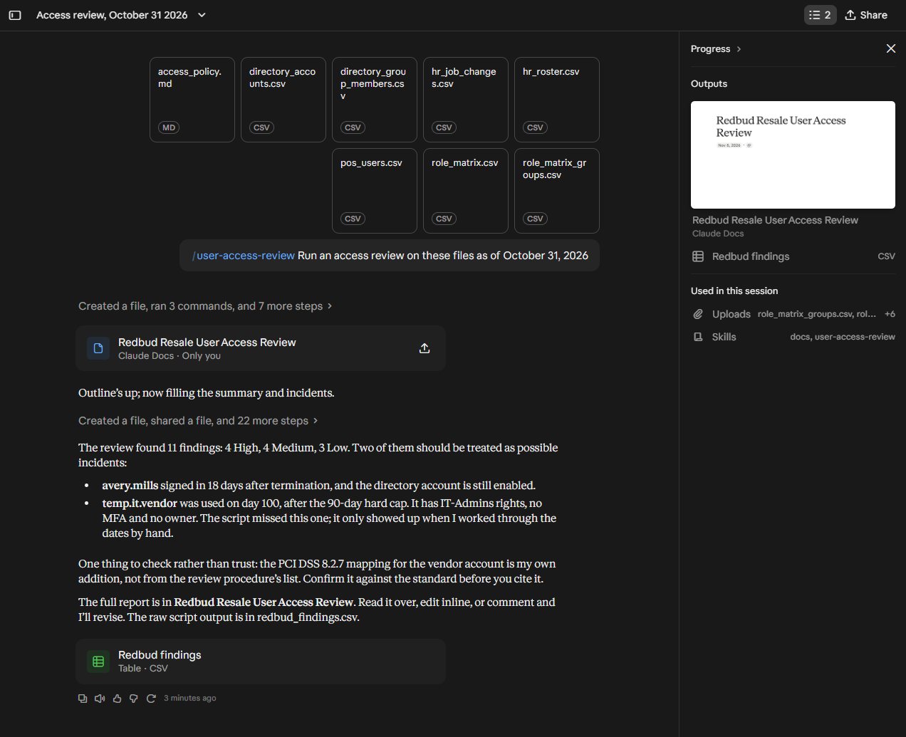

# User Access Review: Redbud Resale Co.

For this project I did a user access review on a made-up retail company. I went through their HR data and account exports, found 11 access problems, figured out what was causing them, redesigned their offboarding process, and then automated the review so it could be run again.

Redbud Resale Co. isn't real. All the names and data are fictional.

## Why I did this

Access reviews come up in a lot of the GRC, IAM, and IT audit jobs I've been applying to. Basically you check that people who left don't still have access, that people only have what their job needs, and so on. I'd learned about it in class but had never actually done one, so I wanted to go through the whole thing myself.

## The setup

Redbud has three stores and a small corporate office, around 34 employees. Everyone logs in with a Microsoft Entra ID account, and the stores use a POS system that takes card payments.

I had seven exports as of October 31, 2026:

- HR roster
- HR job changes
- role matrix (what access each job is supposed to have)
- directory accounts
- directory group memberships
- POS users

I also had the company's access policy, which has 10 rules covering terminations, job changes, inactive accounts, MFA, shared accounts, vendor accounts, and separation of duties. It's in [data/access_policy.md](data/access_policy.md).

## What I found

I did the review by hand in Excel first, going rule by rule and checking each account. I ended up with 11 findings: 4 High, 4 Medium, 2 Low, and 1 policy gap. My full log is in [findings/manual_findings_log.csv](findings/manual_findings_log.csv).

The ones that stood out to me:

- A terminated employee's account was still active, and someone signed into it 18 days after she left. At first I saw it as just another account that needed to be disabled, but a login after someone leaves means the account was actually used. So I treated it as a possible security incident: shut it off right away and find out what was accessed.
- The bookkeeper could create a payment and approve it himself. Even if he's trustworthy, nobody should be able to move money without a second person involved.
- A vendor account had admin rights, no owner, and no MFA, and nobody had used it since May.
- The Domain Admins account didn't have MFA.
- A team leader who was terminated still had her POS login turned on, and her role could approve refunds and voids.

The rest were smaller: someone who moved from accounts payable to marketing still had finance access, a sales associate had manager rights on the register, there was a shared register login, someone who transferred stores still had a login at his old store, and one account hadn't been used in 133 days.

The last one was an employee on leave who still had full access. That wasn't technically a violation, since the policy doesn't say anything about leave, so I logged it as a policy gap and recommended adding a rule for it.

I also checked a few things that looked like problems but weren't. A new hire hadn't logged in yet, but new accounts get 30 days. A service account had no employee attached, but it had a documented owner. And one terminated employee's access had been removed correctly.

## Why it happened

When I grouped the findings together, most of them came back to the same few problems:

1. Access doesn't get removed when people leave or change jobs. HR records the change, but IT either never hears about it or only updates the computer login and forgets about the POS system.
2. People get more access than their job needs, because nobody checks the role matrix when access is given out.
3. Nobody is cleaning up accounts. Old accounts stay open and MFA isn't enforced on the admin accounts.

## Fixing the process

Disabling 11 accounts would fix this review, but the same problems would just show up again next time. So I mapped out how offboarding works now, based on what the data showed, and how it should work instead.

Here's the current state. The red notes show where it breaks and which finding showed it:


And the future state. When HR updates the roster, it automatically creates an access ticket for IT. IT's checklist covers every system, including POS. The store manager collects keys and badges and changes the alarm code. HR confirms everything got done, and anything not finished the same day gets escalated. There's also a monthly check where HR compares the roster to the account lists. I had HR do that one instead of IT so IT isn't checking its own work.


Both diagrams are BPMN files, so you can open and edit them at [demo.bpmn.io](https://demo.bpmn.io).

## Automating it

After doing it all by hand, I wanted a way to run the same review again without starting from scratch. There are two parts to it:

- A Python script ([access_review.py](skill/user-access-review/scripts/access_review.py)) that runs all the policy checks. I wanted the rule checks done by code so they come out exactly the same every time. On the Redbud data it found the same 11 issues I found by hand and cleared the same false alarms.
- A Claude skill ([user-access-review](skill/user-access-review/SKILL.md)) that runs the script and then handles the parts that need judgment, like flagging logins after termination as possible incidents, telling a policy gap apart from a violation, and grouping findings by root cause. It's the same idea as my [SOC triage skill](https://github.com/landonjsn/soc-triage-skill).

If you want to rerun the review on the Redbud data yourself:
```
python skill/user-access-review/scripts/access_review.py data --review-date 2026-10-31 --out findings.csv
```

## Testing the skill

To test the skill, I opened a fresh Claude chat, gave it only the policy and the seven exports (none of my findings), and asked it to run the review as of October 31, 2026.



It found the same 11 issues I did, with the same severities, and cleared the same false alarms. I ran it twice in separate chats and got the same results both times. It also caught a few things I missed:

- The vendor account was actually a second possible incident. It was created February 3, so its 90-day limit ran out May 4, but someone signed into
