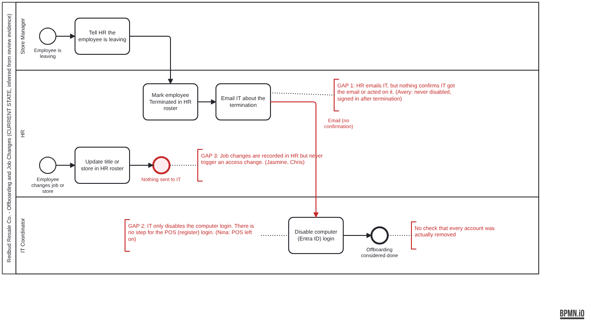
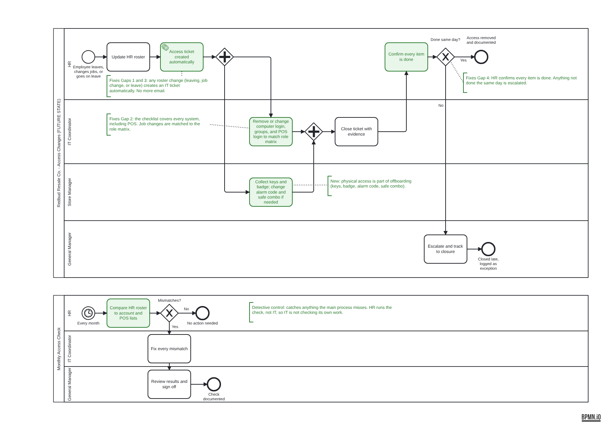

# User Access Review: Redbud Resale Co.

This is a user access review I did for a made-up retail company. I went through their HR roster and account exports, found 11 access problems, figured out which processes were causing them, redesigned their offboarding process, and then automated the review so it can be run again.

Redbud Resale Co. isn't a real company. All the names and data are fictional.

## Why I did this

A lot of the GRC, IAM, and IT audit jobs I'm applying to mention access reviews: checking that terminated employees lost their access, that people only have what their job needs, and so on. I'd learned about it in class but had never actually done one, so I wanted to go through the whole thing start to finish.

## The setup

Redbud has three stores and a small corporate office, about 34 employees total. Employees log in with Microsoft Entra ID accounts, and the stores use a POS system that takes card payments.

I had seven exports as of October 31, 2026:
- HR roster
- HR job changes
- a role matrix (what access each job is supposed to have)
- directory accounts
- directory group memberships
- POS users

I also had their access policy, which has 10 rules about terminations, job changes, inactive accounts, MFA, shared accounts, vendor accounts, and separation of duties. It's in [`data/access_policy.md`](data/access_policy.md).

## What I found

I did the review by hand in Excel first, checking each account against each rule. I ended up with 11 findings: 4 High, 4 Medium, 2 Low, and 1 policy gap. My full log is in [`findings/manual_findings_log.csv`](findings/manual_findings_log.csv).

The ones that stood out:

- **A terminated employee's account was still active, and someone signed into it 18 days after she left.** At first this looked like a missed step, but a login after termination means someone actually used the account. I treated it as a possible security incident: disable it right away and find out what was accessed.
- **The bookkeeper could create a payment and approve it himself.** That's a separation of duties problem. Even if he's trustworthy, nobody should be able to move money without a second person involved.
- **A vendor account had admin rights, no owner, and no MFA,** and nobody had used it since May.
- **The Domain Admins account had no MFA.**
- **A terminated team leader's POS login was still on,** and her role could approve refunds and voids.

The rest: an employee who moved from accounts payable to marketing still had finance access, a sales associate had manager rights on the register, there was a shared register login, a transferred employee still had a login at his old store, and one account hadn't been used in 133 days.

The last one was an employee on leave who still had full access. That one wasn't technically a violation, because the policy doesn't say anything about leave, so I logged it as a policy gap and recommended adding a rule.

I also cleared a few things that looked like problems but weren't: a new hire who hadn't logged in yet (new accounts get 30 days), a service account that had a documented owner, and a terminated employee whose access had been removed correctly.

| Severity | Count |
|---|---|
| High | 4 |
| Medium | 4 |
| Low | 2 |
| Policy gap | 1 |

## Why it happened

When I grouped the findings, most of them came back to the same few problems:

1. **Access doesn't get removed when people leave or change jobs.** HR records the change, but IT either never finds out or only updates the computer login and forgets about the POS system.
2. **People get more access than their job needs,** because nobody checks against the role matrix when access is given out.
3. **Nobody is cleaning up accounts.** Old accounts stay open, and MFA isn't enforced on the admin accounts.

## Fixing the process

Disabling 11 accounts would fix this review, but the same things would show up again next time. So I mapped how offboarding works now (based on what the data showed) and how it should work.

Current state. The red notes are where it breaks, and which finding showed it:



Future state. HR updating the roster automatically creates an access ticket, IT's checklist covers every system including POS, the store manager handles keys and alarm codes, and HR confirms it's all done. If something isn't finished the same day, it gets escalated. There's also a monthly check where HR compares the roster to the account lists. I had HR do that instead of IT so IT isn't checking its own work.



Both diagrams are BPMN files, so you can open and edit them at [demo.bpmn.io](https://demo.bpmn.io).

## Automating it

After doing it by hand, I wanted a way to run the same review again without starting over. There are two pieces:

- **A Python script** ([`access_review.py`](skill/user-access-review/scripts/access_review.py)) that runs all the policy checks. I wanted the rule checks done by code because they should come out exactly the same every time. When I ran it on the Redbud data, it found the same 11 issues I found by hand and cleared the same false alarms.
- **A Claude skill** ([`user-access-review`](skill/user-access-review/SKILL.md)) that runs the script and then handles the parts that need judgment, like flagging logins after termination as possible incidents, telling a policy gap apart from a violation, and grouping findings by root cause. This is the same idea as my [SOC triage skill](https://github.com/landonjsn/soc-triage-skill).

To run the script:

```
python skill/user-access-review/scripts/access_review.py data --review-date 2026-10-31 --out findings.csv
```

## How I built it

I used Claude to help generate the fake company data, draw the BPMN diagrams, and write the Python script. The review itself, the severity calls, and the decisions about what counts as a problem were mine, and I checked the script's results against my own findings.

## Framework mapping

| Area | NIST CSF 2.0 | PCI DSS v4.0 (POS takes card payments) |
|---|---|---|
| Terminated users with access | PR.AA-01 | 8.2.5 |
| Extra access, leftover access, separation of duties | PR.AA-05 | 7.2.2 |
| No MFA on admin accounts | PR.AA-03 | 8.4.1 |
| Shared logins | PR.AA-01 | 8.2.2 |
| Inactive accounts | PR.AA-01 | 8.2.6 |
| Access reviews every 6 months | PR.AA-05 | 7.2.4 |

## What I took away from it

The login after termination was the biggest lesson. I almost logged it as just another account to disable, but someone actually used that account after the person was gone, which is a much bigger deal.

The leave-of-absence finding taught me to look at what the policy doesn't cover, not just what it does.

And fixing the process ended up being more useful than fixing the accounts. Most of the 11 problems came from the same broken handoff between HR and IT.

## What's in here

- `data/`: the access policy and the seven exports
- `findings/`: my manual findings log and the script's output
- `process/`: the current and future state BPMN diagrams
- `skill/user-access-review/`: the Claude skill, the Python script, a report template, and the framework mapping
